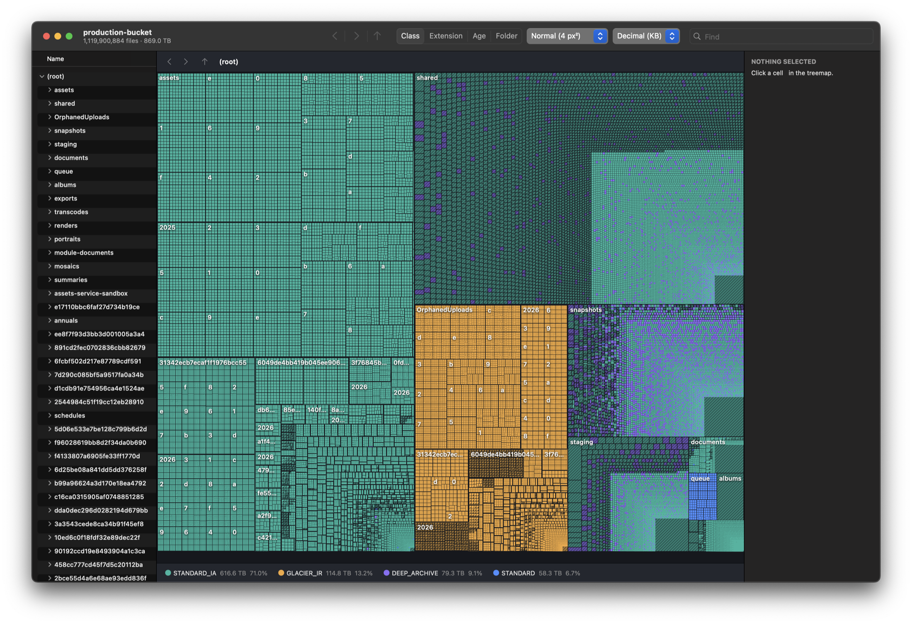

# S3 Inventory Visualizer

A native macOS app that loads an AWS S3 Inventory CSV export and renders a WinDirStat style
treemap of a whole bucket, at billion object scale.

> **It reads an S3 Inventory export. It does not scan S3.**
>
> The app never calls `ListObjectsV2` and never reaches your bucket. You point it at the CSV export
> that [S3 Inventory](https://docs.aws.amazon.com/AmazonS3/latest/userguide/storage-inventory.html)
> writes for you on a schedule you choose. That is what makes a bucket of a billion objects
> practical to look at: no per request charge, no hours of paging, and nothing to throttle.

The teal is `STANDARD_IA`, the amber block is `GLACIER_IR`, and the violet speckles are objects
already in `DEEP_ARCHIVE`.

| | |
|---|---|
| [Colour by folder](docs/screenshots/02-folder.png) | [by extension](docs/screenshots/03-extension.png) |
| [by age](docs/screenshots/04-age.png) | [a directory selected](docs/screenshots/05-directory-selected.png) |
| [zoomed into one prefix](docs/screenshots/06-zoomed-prefix.png) | [a file selected](docs/screenshots/07-file-selected.png) |
| [one storage class isolated](docs/screenshots/08-legend-highlight.png) | [find by prefix](docs/screenshots/09-find-starts-with.png) |
| [find scanning every name](docs/screenshots/10-find-contains-scanning.png) | [its results](docs/screenshots/11-find-contains-results.png) |
| [about](docs/screenshots/12-about.png) | [building an index](docs/screenshots/14-import-progress.png) |

## What it does

- **Treemap.** Flat tiles, sized by bytes, nested by key prefix, separated by a gutter that scales
  with the tile. Each fill is the same colour as its legend swatch. Hover reads the
  full key. Double click zooms into a prefix. The breadcrumb and Back, Forward and Up navigate.
- **Colour modes.** Storage class, file extension, last modified age, or folder. Switching is one
  frame, because the mode is a shader uniform and never triggers a new layout.
- **Colour by folder** gives each of the twenty largest folders directly under whatever you are
  viewing its own hue, largest first, and everything smaller a neutral grey. At the root that turns
  every top level prefix into one readable block. Zoom in and the folders inside take over the
  palette. It is the mode that shows a bucket's shape; the others answer questions about it.
- **Selection.** The chosen cell gets a bright ring with a dark halo. A cell only a few pixels
  across also gets guide lines out to the canvas edges, so it can be found at a glance. When the
  selection covers enough of the canvas to read as a region, the rest is dimmed and desaturated
  instead.
- **Directory tree.** A lazy outline of every prefix, largest first, with a stacked storage class
  bar per row and the 100 largest files inside each prefix. Clicking in the treemap collapses the
  tree, reopens only the path down to what you clicked, and centres it.
- **Details.** Totals, bytes per storage class, the top extensions, and an age histogram.
- **Find.** "Starts with" answers immediately. "Contains" scans every name in parallel with a
  progress bar and a cancel button.

## Build and run

    make test     # unit tests
    make release  # the command line tool at .build/release/s3-inventory-tool
    make app      # the app bundle

Requires Xcode 26 with the Metal toolchain component:

    xcodebuild -downloadComponent MetalToolchain

Open the app and choose the folder that holds `manifest.json` and the inventory data files. The
first open builds an index beside the inventory in `.s3-inventory-index`; later opens are instant.
A folder can also be passed on the command line. Choosing a finished index folder works too, which
is how an index built on another machine is opened.

## Command line tool

    s3-inventory-tool index <inventory folder> [--threads N] [--force] [--allow-missing]
    s3-inventory-tool stats <index folder>
    s3-inventory-tool bench <index folder> [--root <prefix>] [--width W] [--height H]
    s3-inventory-tool lookup <index folder> <key prefix>
    s3-inventory-tool find <index folder> <substring> [--limit N]
    s3-inventory-tool generate-fixture <folder> --rows N [--files F]

## Credits

Guiware LLC, [guipinto.com](https://guipinto.com). Swift, AppKit and Metal, with no third party
code. The same information is in the About panel.
